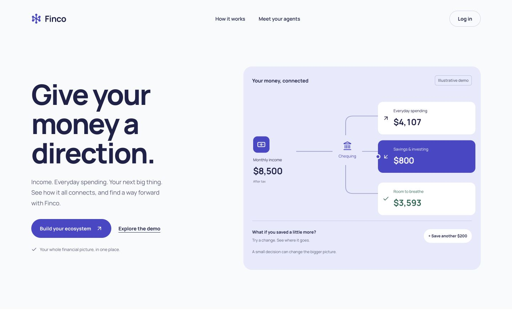
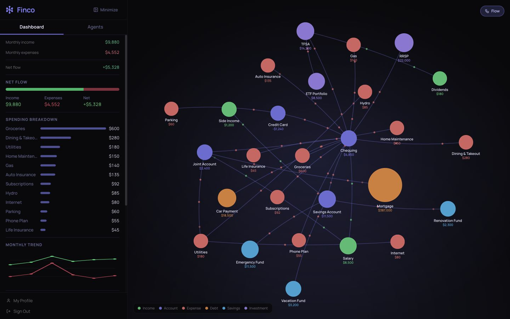
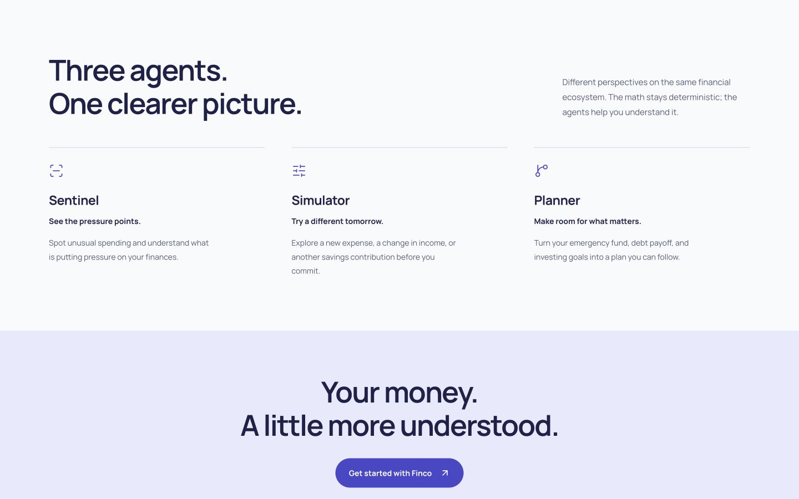

# Finco

Visualize money flow as an interactive node graph, monitor risks with specialized agents, simulate changes, and plan future goals.

## Screenshots

### Landing page

A first look at how income flows through spending, savings and the amount left over.



### Financial ecosystem

The demo graph connects income, accounts, expenses, debt, savings and investments.



### Agent overview

The landing page introduces Sentinel, Simulator and Planner.




---

## What it does

- maps a user's entire financial system as a draggable node-and-edge graph
- nodes represent financial entities (income, accounts, expenses, debt, savings, investments)
- edges represent directional money flow between nodes
- three AI agents analyze, explain, and advise based on the graph and user profile
- deterministic engines handle all math (no LLM math)
- supports CSV import to auto-generate nodes from bank transactions
- user profile drives planning, readiness checks, and agent recommendations

## AI agents

- **Sentinel** -- primary supervisor, graph explainer, anomaly detector, alert writer, pressure-point guide
- **Simulator** -- explains before/after impact of simulated changes in structured short-form output
- **Planner** -- future planning agent for emergency fund, TFSA/RRSP/FHSA, debt payoff, investment readiness, curated ETF suggestions

Librarian was merged into Sentinel. Agents delegate to each other when appropriate.

## Tech stack

- **Frontend** -- Next.js 14 (App Router), TypeScript, React, Tailwind CSS, Radix UI
- **Graph** -- custom canvas renderer with d3-force layout, live physics, pan/zoom
- **Auth** -- Auth0 (Universal Login, v4 SDK)
- **Database** -- Supabase (PostgreSQL)
- **AI runtime** -- Backboard.io (assistants, threads, memory, tools)
- **Deployment** -- Vercel

## Project structure

```
src/
  app/
    (app)/ecosystem/     -- main graph dashboard
    (app)/profile/       -- financial profile form
    (app)/onboarding/    -- onboarding flow
    (auth)/login/        -- redirects to Auth0 login
    (auth)/signup/       -- redirects to Auth0 signup
    api/ai/sentinel/     -- sentinel agent route
    api/ai/simulator/    -- simulator agent route
    api/ai/planner/      -- planner agent route
    api/ai/agent/        -- generic agent dispatcher
    api/profile/         -- profile CRUD
    api/parse-csv/       -- CSV parsing and categorization
  components/
    graph/               -- graph renderer, nodes, edges, legend
    panels/              -- node popup, edge detail, add/edit/delete dialogs, agent chat, simulation overlay, CSV upload
    shared/              -- sidebar, logo, page transition
    landing/             -- landing page (hero, navbar)
  lib/
    auth0.ts             -- Auth0 client setup
    supabase.ts          -- Supabase client setup
    gemini.ts            -- Gemini API calls (fallback for all agents)
    graph-theme.ts       -- node/edge color palette
    graph-transforms.ts  -- domain data to graph data conversion
    demo-data.ts         -- seed data for first load
    csv-import.ts        -- CSV parsing utilities
    simulation-ripple.ts -- deterministic simulation ripple logic
    backboard/           -- Backboard client, assistants, threads, formatters, tools, validators
    rules/               -- Sentinel deterministic rules engine
    planner/             -- readiness checks, timeline estimators
    etf/                 -- curated ETF catalog and filters
  types/
    graph.ts             -- node, flow, edge types
    profile.ts           -- user profile type and enums
    etf.ts               -- ETF type
  data/
    etfs/                -- curated Canadian ETF dataset (JSON)
supabase/
  schema.sql             -- full database schema
```

## Key design decisions

- all financial math is deterministic (rules engines, readiness checks, timeline estimators) -- never delegated to LLMs
- agents receive pre-computed structured data, not raw numbers to calculate
- graph state is the source of truth for financial structure
- Supabase is the source of truth for profile and persistent data
- Backboard handles conversational memory and tool orchestration
- ETF recommendations come only from the curated internal dataset, not web scraping
- node colors use a centralized blue-hue palette defined in `graph-theme.ts`
- edges are strictly straight lines
- graph has live d3-force physics (nodes react to each other on drag)
